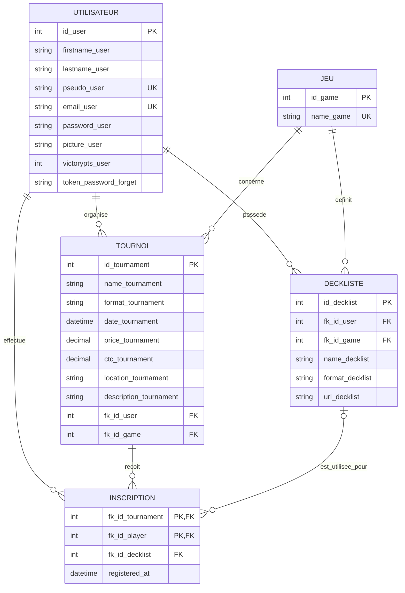

# Modèle de données — Nexus Shuffle

Ce document décrit le modèle déduit du code actuel et propose les clés qui manquent pour rendre les relations explicites. Le projet utilise PostgreSQL. Les noms de tables et de colonnes suivent autant que possible les noms déjà employés dans les requêtes du backend.

## Périmètre retenu

- Un utilisateur peut organiser plusieurs tournois et participer à plusieurs tournois.
- Un tournoi est organisé par un utilisateur et concerne un jeu.
- Un utilisateur peut enregistrer plusieurs decklists, chacune pour un jeu.
- Une inscription relie un utilisateur à un tournoi. Elle peut référencer le deck utilisé.
- Le classement est calculé à partir des points de victoire de l’utilisateur.

Le backend référence déjà `games` et `decklists.fk_id_game`, mais le dépôt ne contient pas le schéma de création de ces tables. De même, le code décrit l’inscription via `tournaments_has_players`, sans date d’inscription ni deck choisi. Le modèle ci-dessous formalise ces éléments.

## MCD



**Cardinalités :** un tournoi a exactement un organisateur et un jeu ; un utilisateur ou un jeu peut être lié à zéro, un ou plusieurs tournois. Une inscription concerne exactement un utilisateur et un tournoi. Le couple tournoi/utilisateur est unique. Le deck est facultatif dans le modèle proposé pour rester compatible avec l’API actuelle ; il pourra devenir obligatoire lorsque le parcours d’inscription transmettra le deck choisi.

## MLD

Notation : `PK` = clé primaire, `FK` = clé étrangère, `UK` = valeur unique, `?` = nullable.

```text
UTILISATEUR(
  id_user             INTEGER PK,
  firstname_user      VARCHAR(50) NOT NULL,
  lastname_user       VARCHAR(50) NOT NULL,
  pseudo_user         VARCHAR(50) NOT NULL UK,
  email_user          VARCHAR(255) NOT NULL UK,
  password_user       TEXT NOT NULL,                 -- hash uniquement
  picture_user        TEXT?,
  victorypts_user     INTEGER NOT NULL DEFAULT 0,
  token_password_forget TEXT?
)

JEU(
  id_game             INTEGER PK,
  name_game           VARCHAR(100) NOT NULL UK
)

TOURNOI(
  id_tournament       INTEGER PK,
  name_tournament     VARCHAR(150) NOT NULL,
  format_tournament   VARCHAR(100) NOT NULL,
  date_tournament     TIMESTAMPTZ NOT NULL,
  fk_id_user          INTEGER NOT NULL FK -> UTILISATEUR(id_user),
  fk_id_game          INTEGER NOT NULL FK -> JEU(id_game),
  price_tournament    TEXT?,
  ctc_tournament      NUMERIC(8,2)?,
  location_tournament VARCHAR(255) NOT NULL,
  description_tournament TEXT?
)

DECKLISTE(
  id_decklist         INTEGER PK,
  fk_id_user          INTEGER NOT NULL FK -> UTILISATEUR(id_user),
  fk_id_game          INTEGER NOT NULL FK -> JEU(id_game),
  name_decklist       VARCHAR(150) NOT NULL,
  format_decklist     VARCHAR(100) NOT NULL,
  url_decklist        TEXT NOT NULL
)

INSCRIPTION(
  fk_id_tournament    INTEGER NOT NULL FK -> TOURNOI(id_tournament),
  fk_id_player        INTEGER NOT NULL FK -> UTILISATEUR(id_user),
  fk_id_decklist      INTEGER? FK -> DECKLISTE(id_decklist),
  registered_at       TIMESTAMPTZ NOT NULL DEFAULT CURRENT_TIMESTAMP,
  PK(fk_id_tournament, fk_id_player)
)
```

## Règles d’intégrité à appliquer

1. `email_user` et `pseudo_user` sont uniques ; les emails sont enregistrés en minuscules après suppression des espaces.
2. L’inscription est unique pour un couple `(fk_id_tournament, fk_id_player)`.
3. Si une inscription référence un deck, ce deck doit appartenir au joueur inscrit et concerner le même jeu que le tournoi. Cette règle peut être contrôlée dans le service d’inscription, ou renforcée en base avec des clés uniques composites et des clés étrangères composites.
4. `victorypts_user` est un entier positif ou nul. Le classement trie les scores décroissants (la requête actuelle trie par ordre croissant).
5. `ctc_tournament` est le prix de participation, nommé `paf` dans le formulaire/API. Il doit être positif ou nul.
6. Les mots de passe sont stockés sous forme de hash. Le jeton de réinitialisation est temporaire et doit être effacé après usage.

## Écarts à traiter dans le code

- Ajouter ou documenter la table `games`, déjà attendue par les requêtes de decklist.
- Ajouter `fk_id_game` à `tournaments` et le fournir lors de la création d’un tournoi ; le code actuel ne stocke que le format texte.
- Ajouter `fk_id_decklist` et `registered_at` à `tournaments_has_players` si l’on veut mémoriser le deck utilisé et la date d’inscription.
- Vérifier que le deck soumis appartient bien à l’utilisateur connecté et correspond au jeu du tournoi.
- Corriger le tri du classement pour utiliser `ORDER BY victorypts_user DESC`.
- Le contrôle de doublon d’un tournoi devrait porter sur la date/heure exacte ; la requête actuelle cherche une égalité entre date complète et paramètre de date.

> Le champ `price_tournament` est gardé en texte car le backend l’utilise comme libellé de récompense (« lots »), alors que `ctc_tournament` est un montant numérique de participation.
